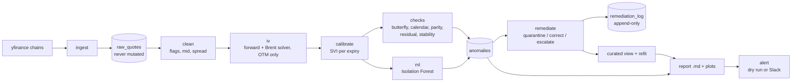

# iv-quality-monitor

A daily data-quality monitor for derivatives implied-volatility data. It pulls
option chains for equities and commodity-proxy ETFs, rebuilds implied
volatilities itself, fits a volatility surface, and flags quotes that are
inconsistent with it or violate no-arbitrage conditions. Findings are
remediated through an auditable policy, summarised in a daily report, and
checked against alert thresholds. Python 3.11+ and DuckDB.

**Underlyings:** SPY, AAPL, NVDA, XOM, and the commodity-proxy ETFs GLD, USO, SLV.

## Why this exists

Vendor option data contains stale quotes, crossed or zero markets, bad strikes
and surfaces that admit arbitrage. A pricing or risk system that consumes them
silently gets wrong Greeks and wrong marks. This project treats that as a data
engineering problem: detect it, explain it, record what was done about it, and
make the whole process reproducible.

## Architecture



Each step only runs if the steps it depends on succeeded. Report and alert
always run, so a failed run produces an alert instead of silence.

## Run it

```powershell
python -m venv .venv
.venv\Scripts\Activate.ps1
pip install -r requirements.txt
pip install -e .
pytest

python -m ivmon.pipeline                # full run, alerts printed (dry run)
python -m ivmon.pipeline --skip-ingest  # re-process the latest stored snapshot
python -m ivmon.pipeline --send-alerts  # post to Slack if SLACK_WEBHOOK_URL is set
```

Pull during US market hours (about 6:30am to 1:00pm Pacific); outside them the
vendor returns 0/0 quotes and the zero-bid alert fires. Reports are written to
`data/reports/`. Scheduling (cron, Windows Task Scheduler, GitHub Actions):
`docs/scheduling.md`.

Each stage can also be run alone: `python -m ivmon.<ingest|clean|iv|svi|checks|ml|synthetic|remediate>`.

## Sample report

_Screenshot placeholder: add `docs/sample_report.png` from a file in `data/reports/`._

## Results (real numbers from the code, snapshot 2026-11-09 20:22:53 UTC)

| What | Result |
|---|---|
| Coverage | 7 underlyings, 42 expiries, 5,792 raw quotes per snapshot |
| Snapshots collected | 3 (one pre-market with 99.4% zero-bid quotes, two during market hours) |
| SVI calibration | 38 of 42 expiries fitted; 4 skipped for too few points (2 to 7 points each) |
| Median SVI fit error | 0.8 to 1.69 vol points per underlying |
| Rule-based findings | 191 on real data (butterfly 11, calendar 9, parity 24, residual outliers 141, stability 6) |
| ML flags | 107 of 2,132 quotes (flag rate is set by the 5% contamination setting, not discovered) |
| Tests | 319 passing |

**Detection on injected corruptions** (119 synthetic corruptions injected into a copy of the snapshot; known ground truth, isolated database):

| Detector | Flagged | Precision | Recall |
|---|---|---|---|
| Rule-based | 346 | 0.251 | 0.731 |
| Isolation Forest | 105 | 0.143 | 0.126 |
| Combined | 393 | 0.239 | 0.790 |

Recall by corruption type (rule-based / ML): swapped bid-ask 1.00 / 0.00,
price spike 0.92 / 0.16, IV shift 0.92 / 0.04, stale quote 0.48 / 0.04,
strike typo 0.21 / 0.47.

Precision is low mainly because real quotes already carry baseline findings
(201 of the rule-based flags are on quotes that were not injected). The ML layer
adds little over the rules here; its one clear contribution is strike typos.

**Remediation:** refitting the surface after remediation did not improve fit
quality: RMSE on 2,034 untouched quotes went from 0.988 to 1.030 vol points
(worse), so the current quarantine/correct policy is not validated.

## Limitations and honest assumptions

- **Snapshot-only data.** yfinance returns only the current chain, so history exists only from the days the pipeline has run. Parameter-stability and trend checks need more snapshots; only two market-hours snapshots exist so far.
- **American vs European.** Listed single-name and ETF options are American. We use Black-76 (European) on OTM quotes only, where early-exercise value is small, but the error is not zero, especially for dividend payers and deep ITM parity.
- **ETF commodity proxies.** GLD, USO and SLV are equity-listed ETFs, not futures options. They stand in for commodity vol and do not have a futures curve, roll or contango effects.
- **Synthetic evaluation.** Injected corruptions are my own, so scores measure sensitivity to those corruption types, not to real vendor errors. Strike typos are only partly testable (quotes on an unsolved or ITM strike are never flagged).
- **ML is near chance** on this data and is kept as a layer to evaluate, not as a trusted detector. Isolation Forest flags wide-spread, near-expiry quotes rather than mispricings.
- **Alert thresholds** are initial round numbers, not calibrated on history.
- **Risk-free rate and dividends** are config assumptions, not market data.
- **Scheduling:** the GitHub Actions workflow has not been run; its history is stored in an evictable cache.

## Layout

- `src/ivmon/` package code (one module per pipeline step)
- `tests/` pytest suite (319 tests)
- `data/` DuckDB file and generated reports (gitignored)
- `docs/methodology.md` SVI, arbitrage conditions, forward estimation
- `docs/design-decisions.md` decision log
- `docs/scheduling.md` scheduling and cron vs Airflow
